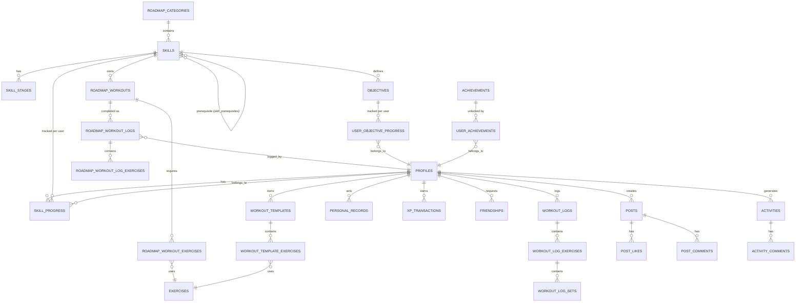

# Calisthenics Progression Platform — Backend v1.0

Pure Supabase: PostgreSQL + Supabase Auth + Row Level Security + PostgREST + RPC + Realtime + Storage.
No custom API server. Any future AI/computer-vision feature attaches later as an independent
microservice that talks to Postgres directly — it doesn't change this core.

Files:
- `schema.sql` — all tables, enums, indexes, constraints
- `rls_functions_views.sql` — RLS policies, RPC functions, triggers, views
- This document — ERD, rationale, storage, seed strategy, performance notes

---

## 1. Mermaid ERD (core relationships)



*(The full schema has 30+ tables — this diagram shows the load-bearing relationships;
the two full SQL files are the source of truth.)*

---

## 2. Normalization

Everything is 3NF except two deliberate denormalizations, both justified:

1. **`roadmap_workout_logs.workout_snapshot` (JSONB)** — duplicates the workout's required
   exercises at completion time. This is *intentional* denormalization: it protects historical
   logs from corruption when an admin later edits `roadmap_workout_exercises`. Without it,
   editing live content would retroactively change what a user's old "completed" log means.
2. **`skill_progress.current_xp` / `completion_percentage`** — cached aggregates, kept in sync
   only through `award_xp()` and future completion-recalculation triggers, never written
   directly by the client. This trades strict normalization for read performance on the
   single most-queried row in the app (the roadmap screen).

Everything else — objectives, stages, prerequisites, PRs, achievements — is modeled as
proper 1:1/1:M/M:M with junction tables carrying only relationship-specific attributes.

---

## 3. Why the two systems are separate but share two things

- **Shared:** `profiles` (identity) and `exercises` (the exercise library) — both systems
  reference exercises, but nothing else crosses over. `personal_records` (gym tracker) and
  `roadmap_personal_bests` (roadmap) are intentionally separate tables per your decision.
- **Independent:** workout tracker tables never reference `skill_id`, `xp_reward`, or any
  roadmap table. Deleting the entire roadmap system would leave the tracker fully functional,
  and vice versa. This is enforced structurally, not just by convention.
- **Social is its own third pillar**, and its primary feature is a public photo feed
  (`posts` → `post_likes` / `post_comments`), not an auto-generated roadmap activity log.
  `posts` is visible to every app user (not friends-only) subject only to blocks. The
  `activities`/`activity_comments` tables (roadmap-event feed) still exist in the schema
  but are currently dormant — no RPC writes to them yet; revisit once the roadmap-completion
  flows are further along. `friendships`/`blocks` remain independent of both — they gate
  visibility on `posts`/`post_comments` (via `is_blocked()`) but friendship status doesn't
  gate the public feed itself, only comment/like visibility toward blocked users.

---

## 4. Security model (RLS strategy)

Three tiers of table, three different policy shapes:

| Tier | Examples | Policy shape |
|---|---|---|
| **User-owned data** | `workout_templates`, `workout_logs`, `body_metrics_log` | `using (user_id = auth.uid())` for all operations |
| **Global content, admin-only writes** | `skills`, `exercises`, `roadmap_workouts`, `achievements` | Public `select`, `all` gated by `is_admin()` |
| **Progress data — read-only for the client** | `skill_progress`, `xp_transactions`, `personal_records`, `roadmap_workout_logs.completed/xp_awarded` | Client gets `select` only; every mutation goes through a `security definer` RPC (`award_xp`, `complete_roadmap_workout`, the PR trigger) |

The third tier is the important one: with a pure-Supabase/PostgREST setup, any table a client
can `UPDATE` directly is a table a modified client can cheat on. XP, skill status, and PRs are
never in the client's write path — only RPC functions running as the function owner (not the
calling user) can move those numbers, and those functions validate inputs before writing.

Blocks and friendships gate visibility in both directions via `is_blocked()`/`are_friends()`
helper functions, reused across `activities`, `activity_comments`, and friend-request inserts.

---

## 5. Supabase Storage buckets

| Bucket | Access | Policy |
|---|---|---|
| `avatars` | Public read, owner write | Path convention `avatars/{user_id}/*`; storage RLS: `bucket_id = 'avatars' and (storage.foldername(name))[1] = auth.uid()::text` for insert/update/delete |
| `exercise-media` | Public read, admin write | Path `exercise-media/{exercise_id}/*`; write policy gated by `public.is_admin()` |
| `skill-media` | Public read, admin write | Same pattern, `skill-media/{skill_id}/*` |
| `post-media` | Public read, owner write | Path `post-media/{user_id}/*`; same owner-folder pattern as avatars |

```sql
insert into storage.buckets (id, name, public) values
  ('avatars', 'avatars', true),
  ('exercise-media', 'exercise-media', true),
  ('skill-media', 'skill-media', true),
  ('post-media', 'post-media', true);

create policy "post_media_owner_write" on storage.objects for insert
  with check (bucket_id = 'post-media' and (storage.foldername(name))[1] = auth.uid()::text);

create policy "avatar_owner_write" on storage.objects for insert
  with check (bucket_id = 'avatars' and (storage.foldername(name))[1] = auth.uid()::text);
create policy "avatar_owner_update" on storage.objects for update
  using (bucket_id = 'avatars' and (storage.foldername(name))[1] = auth.uid()::text);

create policy "exercise_media_admin_write" on storage.objects for insert
  with check (bucket_id = 'exercise-media' and public.is_admin());
create policy "skill_media_admin_write" on storage.objects for insert
  with check (bucket_id = 'skill-media' and public.is_admin());
```

---

## 6. Realtime

Enable Realtime (via `supabase_realtime` publication) on tables the UI should update live:

```sql
alter publication supabase_realtime add table public.notifications;
alter publication supabase_realtime add table public.skill_progress;
alter publication supabase_realtime add table public.activity_comments;
```
`skill_progress` and `notifications` are the two that matter most for a "coach app" feel —
XP bars and unlock animations updating without a manual refresh.

---

## 7. Soft delete strategy

`deleted_at timestamptz` on: `profiles`, `exercises`, `skills`, `objectives`, `roadmap_workouts`,
`achievements`, `workout_templates`, `activity_comments`. Reasoning: these are all either
user-generated content someone might want restored, or admin content where hard-deleting would
cascade-orphan historical logs (`roadmap_workout_logs.workout_snapshot` already protects against
that, but soft delete avoids breaking FKs entirely). Everything else (logs, transactions,
progress rows) is treated as an immutable/append-only record and hard-deletes only via
`on delete cascade` when the owning user is removed.

---

## 8. Seed data strategy

1. `roadmap_categories` — 4 rows (Pull, Push, Core, Legs), hand-authored.
2. `muscle_groups` and `exercises` — seed the ~30–50 calisthenics exercises referenced by the
   roadmap first (pull-up, muscle-up progressions, handstand drills, etc.), then backfill the
   general gym exercise library (~150 exercises) for the tracker.
3. `skills`, `skill_prerequisites`, `skill_stages`, `objectives`, `roadmap_workouts` +
   `roadmap_workout_exercises` — author these together per skill (a "skill pack" migration per
   skill keeps PRs reviewable — e.g. `seed_skill_muscle_up.sql`).
4. `achievements` — all 35+ in one seed file, `criteria` as JSONB following a fixed shape, e.g.
   `{"type": "skill_completed", "skill_slug": "muscle-up"}` or `{"type": "streak_days", "value": 30}`.
   The evaluator (a future RPC, not built in v1.0 unless you want it now) pattern-matches on
   `criteria->>'type'`.
5. Do **not** seed `skill_progress` rows in migrations — call `initialize_user_skill_progress()`
   from the Supabase Auth `on_auth_user_created` trigger so every new user gets their rows
   generated from whatever skills exist *at signup time*.

```sql
-- attach to auth.users
create or replace function public.handle_new_user()
returns trigger language plpgsql security definer as $$
begin
  insert into public.profiles (id, username) values (new.id, 'user_' || substr(new.id::text, 1, 8));
  perform public.initialize_user_skill_progress(new.id);
  return new;
end;
$$;
create trigger on_auth_user_created
  after insert on auth.users
  for each row execute function public.handle_new_user();
```

---

## 9. Performance notes

- `gin_trgm_ops` indexes on `exercises.name` and `profiles.username` for fuzzy search/autocomplete.
- `xp_transactions` and `roadmap_workout_logs` will be your fastest-growing tables — both are
  append-only and indexed on `(user_id, ..., created_at desc)`, matching the "recent activity"
  query pattern. Partition by month once either passes a few million rows; not needed for v1.
- `v_user_roadmap` view is the one query the client fires constantly (roadmap screen). Keep it
  index-backed (`skill_progress(user_id, status)` already covers it) rather than materializing
  it — the underlying table is small (rows = skills × users, not activity volume).

## 10. Deferred to a later version (flagged, not built)

- Achievement-criteria evaluator RPC (structure is ready via `achievements.criteria` JSONB;
  the evaluation function itself is a v1.1 task once you've finalized the exact criteria types).
- Weekly challenge auto-generation job (`pg_cron` schedule calling an RPC that inserts next
  week's `weekly_challenges` rows) — table shape is ready, scheduler is a follow-up.
- Content localization tables, if/when you go multi-language.
